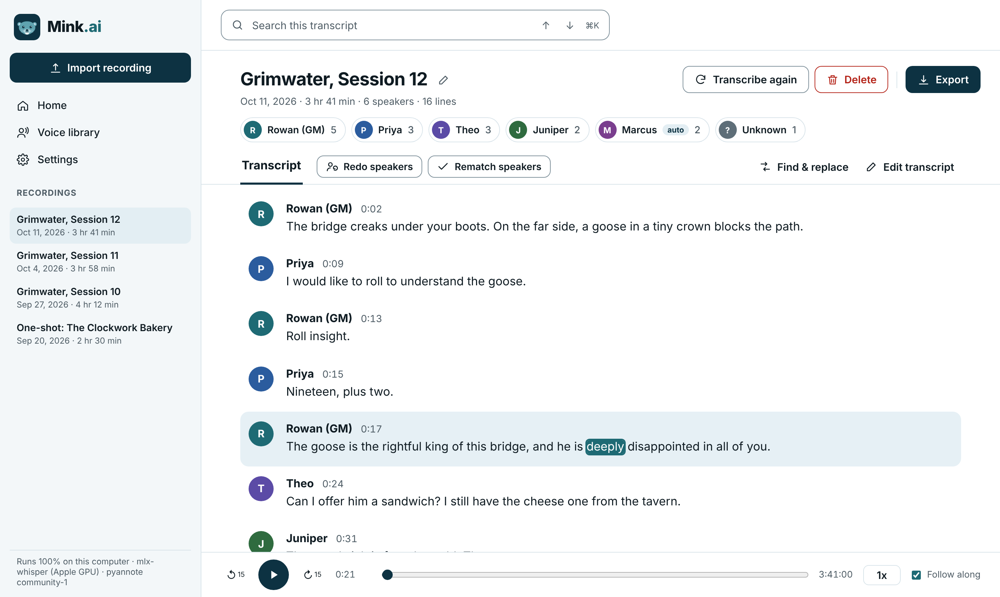
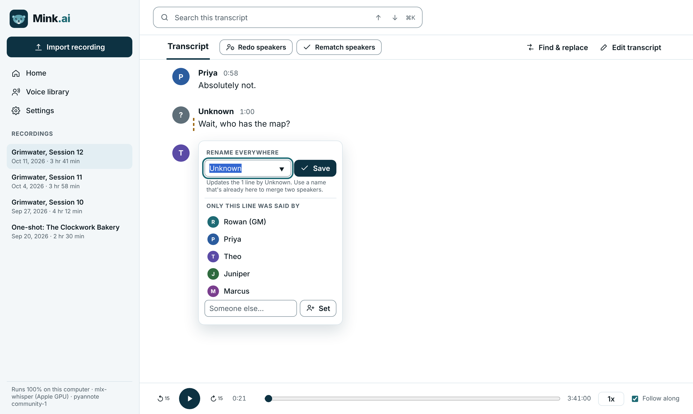
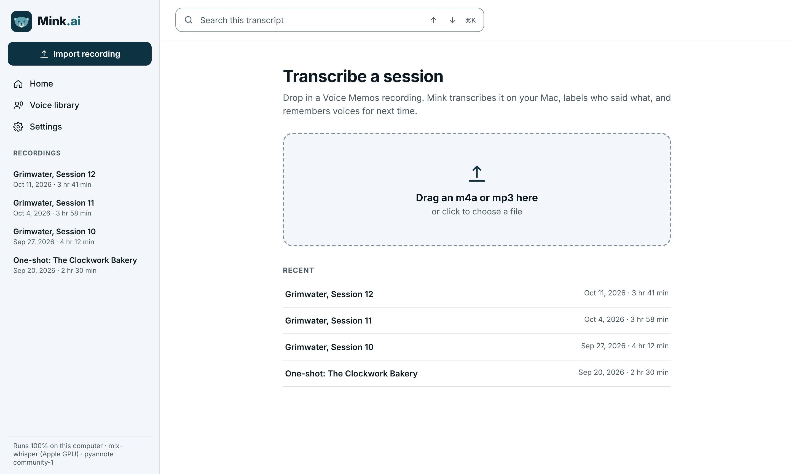

# Mink AI

Mink AI is a private, localized, voice transcription tool for transcribing recordings. It's especially focused on long recordings with multiple speakers, often speaking over one another. It runs entirely on your local machine and is currently design for Mac computers. 

<p>
  <a href="https://github.com/shinabarger/Mink-AI/releases/latest/download/Mink.dmg"></a>
</p>

Free and open source. Apple Silicon Macs (M1 or newer), macOS 14 or later. [Install steps](#install)



<details>
<summary>More screenshots</summary>

**Fix a speaker in two clicks.** Rename someone everywhere, or move just one line to the right person.



**Home.** Drag in a recording to start. Everything stays on your Mac.



</details>

## Requirements

- A Mac with Apple Silicon (M1 or newer) running macOS 14 or later
- About 5 GB of free disk space
- An internet connection for the first run to download the models

## Install

1. **[Download Mink.dmg](https://github.com/shinabarger/Mink-AI/releases/latest/download/Mink.dmg)** and open it.
2. **Drag Mink onto the Applications folder** in the window that opens.
3. **Open Mink from Applications.** The first time, macOS blocks it. See the next section, it takes about 30 seconds.
4. **Wait for setup.** The first launch downloads what Mink needs and takes a few minutes. After that, Mink opens in seconds.

### Getting past the macOS security warning

Mink is free, so it isn't signed with Apple's paid developer certificate. macOS shows a warning the first time you open it. You only do this once.

**macOS 15 (Sequoia) or later**

1. Open Mink. When macOS says it can't verify Mink, click **Done**.
2. Open **System Settings → Privacy & Security**.
3. Scroll down to **Security**. Next to "Mink was blocked to protect your Mac", click **Open Anyway** and enter your Mac password.
4. Open Mink again and click **Open Anyway**.

**macOS 14 (Sonoma)**

1. In Applications, **right-click** Mink (or Control-click) and choose **Open**.
2. Click **Open** in the warning.

<details>
<summary>macOS says Mink "is damaged and can't be opened"</summary>

The app isn't damaged. macOS shows this for some downloaded apps that aren't signed. Open Terminal and paste:

```
xattr -dr com.apple.quarantine /Applications/Mink.app
```

Then open Mink normally.

</details>

To quit, press `Cmd + Q`. If a transcription is still running, Mink asks first. Settings are under **Mink → Settings…** (`Cmd + ,`), including a **Restart Mink** button if anything gets stuck.

<details>
<summary>Run from source instead</summary>

1. Download this repository (green **Code** button → **Download ZIP**) or clone it with [GitHub Desktop](https://desktop.github.com).
2. In Terminal, go to the folder and start Mink:
   ```
   cd ~/Documents/mink
   bash start.command
   ```
   Your browser opens Mink at http://127.0.0.1:8765. Leave Terminal open while you use it, and press `Ctrl + C` to quit.

</details>

## Add your own Hugging Face key (recommended, free)

Mink works out of the box, but its speaker labels are much better with the free [pyannote](https://huggingface.co/pyannote/speaker-diarization-community-1) model. That model needs your own free Hugging Face access token, which you'll have to acquire.

**Get a key:**

1. Create a free account at [huggingface.co/join](https://huggingface.co/join).
2. Open the [speaker model page](https://huggingface.co/pyannote/speaker-diarization-community-1) while signed in, fill in the short form, and click **Agree**. Without this step the key won't work.
3. Go to [huggingface.co/settings/tokens](https://huggingface.co/settings/tokens/new?tokenType=read), choose the **Read** token type, give it any name (for example `mink`), and click **Create token**.
4. Copy the token. It starts with `hf_`.

**Put the key in Mink AI:**

1. Open Mink and click **Settings** in the left sidebar.
2. Paste the token into the box under **Better speaker labels** and click **Save**.
3. The bottom of the sidebar should now say **pyannote community-1**.

Your key is saved only on your Mac, in `~/Mink/settings.json`, which is outside this project folder. Never paste it into any file in this project, and never share it publicly. If it leaks, delete it on the Hugging Face tokens page and create a new one.

## Updating

Download the latest **Mink.dmg** and drag it into Applications again, choosing **Replace**. Your recordings and settings are kept.

## Where your data lives

| What | Where |
|---|---|
| Recordings, transcripts, settings | `~/Mink` |
| Mink's Python packages | `~/Library/Application Support/Mink` |
| Log, for troubleshooting | `~/Library/Logs/Mink` (or **Help → Show Mink Log**) |

To uninstall, drag Mink from Applications to the Trash and delete those folders.

## Making a new release

1. Update `version` in `pyproject.toml` and commit.
2. On GitHub, go to **Releases → Draft a new release**, create a tag like `v1.1.0`, and click **Publish release**.
3. GitHub builds `Mink.dmg` and attaches it to the release in about 5 minutes. The download link above always points to the newest one.

## Accessibility

Mink AI aims for WCAG 2.2 AA.

## License

MIT. Speech recognition by [Whisper](https://github.com/openai/whisper); speaker labels by [pyannote](https://github.com/pyannote/pyannote-audio) and [sherpa-onnx](https://github.com/k2-fsa/sherpa-onnx). Each model has its own license.
